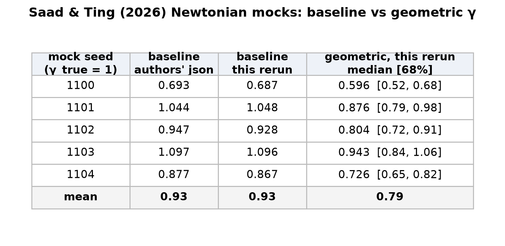
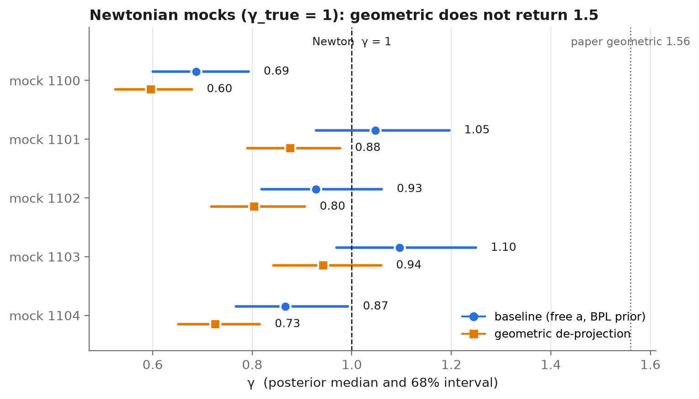
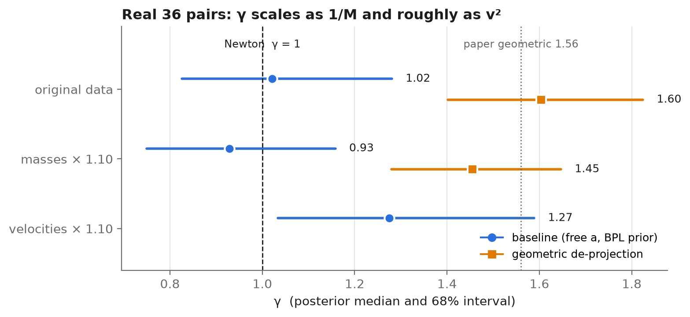

# wb3d-gamma-recheck

Re-running the public code of Saad & Ting (2026), *No Gravitational Anomaly in Wide Binaries from Forward Modelling of 3D Orbits* ([arXiv:2603.11015](https://arxiv.org/abs/2603.11015), code [seratsaad/wb3d-gamma](https://github.com/seratsaad/wb3d-gamma) at commit `4333e9f`), with three checks:

1. **Mock test with the geometric model.** The paper's Appendix C fits its Newtonian synthetic catalogues with the baseline model only. Here the same catalogues are rebuilt and also fitted with the geometric de-projection model.
2. **Masses × 1.10.** Every stellar mass in the input is multiplied by 1.10 and the analysis is rerun.
3. **Velocities × 1.10.** The observed relative velocities (RV difference and proper-motion difference) are multiplied by 1.10, with masses unchanged.

> **요약 (Korean).** Saad & Ting 공개 코드를 그대로 사용했습니다. (1) 논문 Appendix C의 Newton mock catalogue를 저자 seed로 다시 만들고 geometric 모델로도 적합했습니다. 결과는 1.5가 아니라 평균 0.79입니다. (2) 질량을 1.10배 하면 γ는 정확히 1/1.10배가 됩니다. (3) 속도를 1.10배 하면 baseline γ는 1.25배가 됩니다.

## Results

### 1. Newtonian mocks: geometric does not return 1.5





- **Same catalogues as the authors.** The baseline fits reproduce the authors' published recoveries in `injection_recovery.json` (0.693, 1.044, 0.947, 1.097, 0.877) to within 0.02. Different catalogues would differ by 0.1 to 0.2.
- **Geometric gives γ below 1.** On the same Newtonian catalogues the geometric model gives 0.60 to 0.94, mean 0.79, which is about 14% below baseline on every mock. On the real data it is the reverse: geometric is 57% above baseline (1.60 vs 1.02). This test therefore does not show that geometric de-projection by itself turns Newtonian data into γ ≈ 1.5.
- **Limits of the test:**
  - It checks the geometric branch of the Saad & Ting code, not Chae's own pipeline.
  - The mocks anchor each orbit to the observed projected separation, which matches the geometric model's own assumptions.
  - Hidden companions and selection effects are not part of the mocks.
  - The mocks use a 5% separation error, while the real-data fit uses the code's much larger value (see Notes).
  - Four of the five geometric fits mixed less well (r̂ 1.02 to 1.03, ESS 138 to 504).

### 2. Real data: masses and velocities scaled by 1.10



| Input | baseline γ [68%] | geometric γ [68%] |
|---|---|---|
| original | 1.021 [0.825, 1.281] | 1.604 [1.402, 1.824] |
| masses × 1.10 | 0.929 [0.749, 1.158] | 1.455 [1.280, 1.647] |
| velocities × 1.10 | 1.275 [1.033, 1.589] | not run |

- **Masses × 1.10.** Mass enters the model only through γ·G·(M1+M2) and the mass ratio, so scaling every mass by 1.10 is the same as scaling γ by 1/1.10. `check_degeneracy.py` confirms this: the likelihood agrees to about 1e-11 at random parameter points. The MCMC ratios are 1.099 (baseline) and 1.102 (geometric).
- **Velocities × 1.10.** This is not an exact rescaling, because measurement errors, the 40 m/s RV systematic, the jitter terms and the free systemic velocity are not scaled. The baseline ratio is 1.248, a little above the naive 1.1² = 1.21.

## How to run

Requires Python 3.11. On Windows without a C compiler, PyTensor cannot compile C code, so all fits use the `nutpie` (numba) NUTS sampler. Draws, tuning, chains, target acceptance and seeds match the original scripts.

```bash
pip install -r requirements.txt
```

**Real-data runs (about 35 to 40 min each, 4 cores):**

```bash
python make_x110.py data_orig/chae_2026_data.csv data_x110/chae_2026_data.csv 1.10
```

```bash
python make_v110.py data_orig data_v110 1.10
```

```bash
python run_one.py orig baseline
```

`run_one.py <orig|x110|v110> <baseline|geometric>` writes `out/gamma_<data>_<model>.json` (summary) and `.npy` (posterior samples). For the 4 pairs with no mass in the input, `make_x110.py` scales the code's default of 1.0 M☉ per star, so they get 1.1 M☉.

**Mass/γ degeneracy check (seconds):**

```bash
python check_degeneracy.py
```

**Mock catalogues and fits (about 3 h for 10 fits run in parallel):**

```bash
python gen_mocks.py
```

```bash
python run_mock.py mocks/mock_g1.0_k0_seed1100.csv geometric
```

**Figures:**

```bash
python make_figures.py
```

## Files

| File | What it is |
|---|---|
| `run_gamma_analysis.py`, `run_injection.py` | Unchanged copies of the Saad & Ting code (commit `4333e9f`, MIT). Only `prepare_data`, `build_gamma_model` and `simulate` are imported. |
| `data_orig/` | Unchanged input data from the Saad & Ting repository (36 pairs from Chae 2026). |
| `data_x110/`, `data_v110/` | Inputs with masses × 1.10, and with RV and PM differences × 1.10. |
| `make_x110.py`, `make_v110.py` | Build the scaled inputs. `make_v110.py` keeps star A fixed and moves star B so that each B − A difference is exactly × 1.10. |
| `run_one.py` | Fits one real-data input with the baseline or geometric model and saves the γ posterior. |
| `check_degeneracy.py` | Evaluates the likelihood at matched parameter points to show that M × 1.10 is equivalent to γ / 1.10. |
| `gen_mocks.py` | Rebuilds the Appendix C synthetic catalogues with `run_injection.simulate`. |
| `run_mock.py` | Fits one mock catalogue with the original model and the settings recorded in `injection_recovery.json`. |
| `mocks/` | The 10 regenerated catalogues (γ_true = 1.0 and 1.6, five each), in the code's prepared SI-unit format. |
| `out/`, `out_mock/` | Summaries (`.json`: median, 68% and 95% intervals, P(γ>1), r̂, ESS, divergences) and posterior samples (`.npy`). |
| `make_figures.py` | Draws the figures in `figures/` from the saved results. |

## How the mock seeds were obtained

The paper does not list seeds. `run_injection.py` builds catalogue *k* with seed `seed + int(100·γ_true) + k`, and the authors' `injection_recovery.json` records `seed = 1000`, `gammas = 1.0,1.6` and `n_datasets = 5`. This gives seeds 1100 to 1104 for γ_true = 1.0 and 1160 to 1164 for γ_true = 1.6, with MCMC seeds 1000 + k.

`injection_recovery.json` names its input files `chae_2026_clean_sample.csv` and `chae_2025_complete.csv`, while the repository ships `chae_2026_data.csv` and `chae_2026_gaia.csv`. The reproduced baseline values show that the contents match. The small differences (≤ 0.02) come from the different NUTS implementation and from Monte Carlo noise; the catalogues themselves are identical.

## Notes on the original code

These were found while re-running the code and are reported as observations; they are not changed here.

- **Separation error in the baseline.** `prepare_data` sets the projected-separation error to `max(0.05·s, σ_d)`, where `σ_d` is the error of the *distance* and is not multiplied by the angular separation. For these 36 pairs this gives σ_s/s ≈ 188% (median); θ·σ_d would give about 0.09%. The geometric branch uses `s` directly and is much less affected.
- **Mock noise differs from the real-data fit.** `run_injection.simulate` sets the mock separation error to 5% and multiplies the real-data error by zero, so the appendix test is not run under the same separation error as the real-data fit.
- **γ_true = 1.6 results not in the paper.** In `injection_recovery.json`, two of the five γ_true = 1.6 mocks were recovered at 1.18 and 1.21. These fits are not reported in the paper.
- **Missing masses.** Pairs 55, 57, 59 and 60 have no mass in the input and fall back to 1.0 M☉ per star.
- **PM-difference error.** The proper-motion difference error is computed as 0.5·√(σ²_A,tot + σ²_B,tot), about 1/√2 of the per-component value √(σ²_A + σ²_B).
- **Save step fails.** With `sma_prior="bpl"`, `run_analysis` reads `a_over_robs`, which does not exist in that branch, so the save step fails.

## Credit and license

- **Analysis code and input data:** Serat M. Saad & Yuan-Sen Ting, [seratsaad/wb3d-gamma](https://github.com/seratsaad/wb3d-gamma), MIT license as stated in that repository's README.
- **Pair measurements:** Chae (2026), [arXiv:2601.21728](https://arxiv.org/abs/2601.21728).
- **Scripts added in this repository:** MIT (see `LICENSE`).
